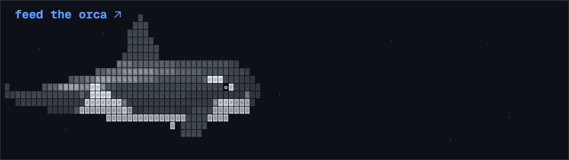

# Ezra Song

I study Honours Math at Waterloo. I worked on web and iOS/macOS apps at Unmodal Research.

[Website](https://ezrasong.me/) · [Résumé](https://ezrasong.me/Ezra_Song_Resume.pdf) · [LinkedIn](https://www.linkedin.com/in/e34song/)

<a href="https://ezrasong.me/">
  <picture>
    <source media="(prefers-reduced-motion: reduce)" srcset="assets/orca-still.png">
    
  </picture>
</a>

## Projects

<table>
  <tr>
    <td width="50%" align="center"></td>
    <td width="50%" align="center">
      <a href="https://github.com/ezrasong/sonolyth">
        <picture>
          <source media="(prefers-color-scheme: light)" srcset="assets/sonolyth-light.svg">
          
        </picture>
      </a>
    </td>
  </tr>
  <tr>
    <td valign="top"><strong><a href="https://ezrasong.me/seoul.html">Mini Seoul</a></strong> Drive a poro around Seoul and knock on doors to see my work. <a href="https://github.com/ezrasong/ezrasong.github.io">Source</a></td>
    <td valign="top"><strong><a href="https://github.com/ezrasong/sonolyth">Sonolyth</a></strong> My Android fork of Spotube, with lossless playback, synced lyrics, and playlist folders.</td>
  </tr>
</table>

More projects

- [WalkWithMe](https://github.com/ezrasong/WalkWithMe) lets you schedule check-ins from a phone or Wear OS watch.
- [Discord Automation Bot](https://github.com/ezrasong/Discord-Bot) adds moderation, reaction roles, AMP server controls, and queued music to Discord.
- [UW Course Planner](https://github.com/ezrasong/UW-Course-Planner) saves Waterloo schedules and lets you drag courses between terms.
- [Lowcord](https://github.com/ezrasong/lowcord) is a slim Electron Discord client forked from Legcord.
- [LeReplacer](https://github.com/ShreyShingala/LeReplacerExtension) swaps faces live in the browser.
- [Claude + Kiro Proxy](https://github.com/ezrasong/claude-kiro-proxy) connects Claude Code Proxy to Kiro Gateway from the CLI.

[All repositories](https://github.com/ezrasong?tab=repositories)

## GitHub activity

<a href="https://github.com/ezrasong?tab=overview">
  <picture>
    <source media="(min-width: 1024px)" srcset="assets/github-metrics-wide.svg">
    
  </picture>
</a>

Hackathons

- UltraHacks 2026 · Best Use of ElevenLabs (MLH)
- UTMIST AI Tournament 2025 · Top 8
- Go On Hacks 2025 · Best Pitch for LeReplacer

